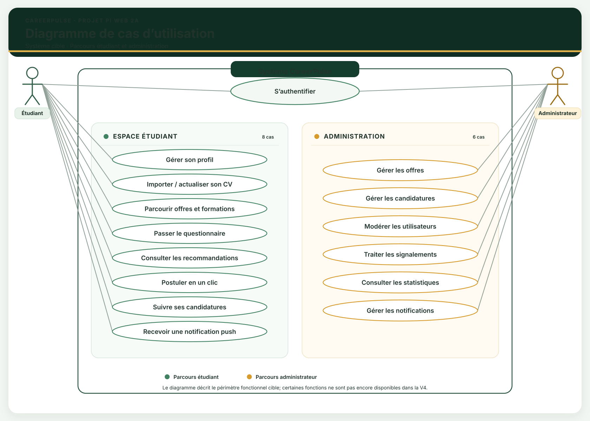

# Diagramme de cas d’utilisation — CareerPulse

## Portée et état dans la V4

Le schéma représente le **système cible du projet**, et non uniquement les fonctions déjà présentes dans le prototype V4.

- Déjà présentes dans la V4 : authentification étudiant, profil, consultation du catalogue, candidatures et suivi; côté administration, offres, candidatures, utilisateurs, signalements, statistiques et notifications.
- À réaliser pour couvrir entièrement le concept : import de CV, questionnaire, moteur de recommandations et notifications push réelles. Les scores du catalogue sont des valeurs fournies avec les données d’exemple.
- L’authentification administrateur est représentée dans la cible, mais les routes d’administration V4 ne l’imposent pas encore.

Les associations relient chaque acteur aux fonctions qu’il utilise. Les relations `<<include>>` et `<<extend>>` de l’ancienne version ont été retirées : consulter une offre n’oblige pas à postuler, et les recommandations ne forcent pas nécessairement l’étudiant à refaire le questionnaire à chaque consultation.

La source éditable PlantUML est disponible dans [CAS_UTILISATION.puml](CAS_UTILISATION.puml).