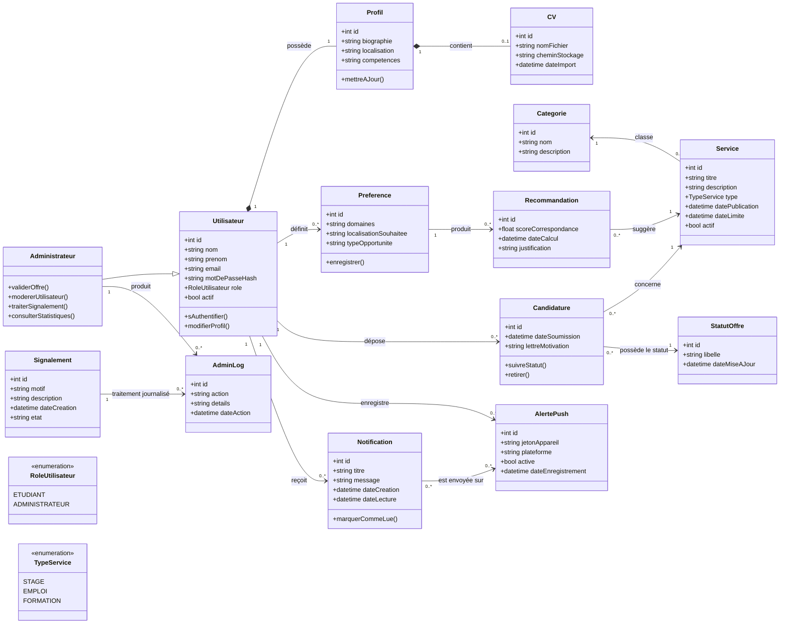

# Diagramme de classes — CareerPulse

**Version de travail préparatoire.** Le modèle ci-dessous reprend les modules présentés pour CareerPulse. Les attributs, opérations et cardinalités qui ne sont pas explicitement décrits dans le support sont des propositions à valider par le groupe et les tuteurs avant la conception de la base de données.

## Hypothèses à confirmer

- `Service` désigne une opportunité du catalogue (stage, emploi ou formation), selon les modules présentés.
- `StatutOffre` est le nom présent dans les éléments préparatoires; l'équipe peut retenir `StatutCandidature` si les statuts décrivent plutôt l'avancement d'une candidature.
- Le CV, les préférences, les notifications push et les journaux d'administration sont modélisés comme classes distinctes pour couvrir les fonctions annoncées. Leurs champs et cardinalités sont des propositions de conception.
- L'association entre `Signalement` et `AdminLog` représente une traçabilité possible du traitement; les tuteurs peuvent demander une autre structure.
- Les types, attributs et opérations sont à ajuster après validation métier et choix de la base de données.