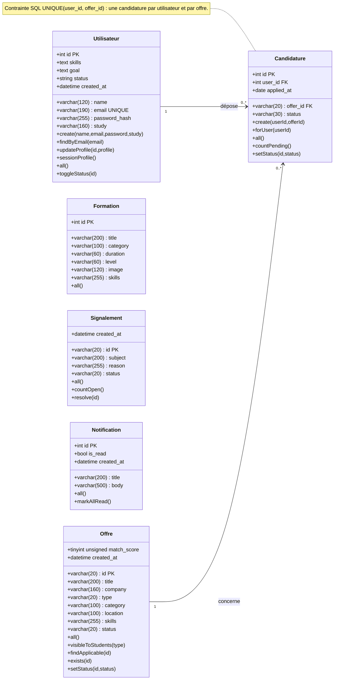

# Diagramme de classes — CareerPulse V4

Ce diagramme représente les classes de données réellement persistées dans la V4, d’après `database/careerpulse.sql` et les modèles PHP. Les deux associations indiquées sont les seules relations avec clés étrangères dans ce schéma.

## Lecture du modèle

- Un utilisateur peut déposer plusieurs candidatures; chaque candidature appartient à un seul utilisateur.
- Une offre peut recevoir plusieurs candidatures; chaque candidature concerne une seule offre.
- `skills`, `study` et `goal` sont des champs de `Utilisateur` : la V4 n’a pas de table `Profil` distincte.
- `Formation`, `Signalement` et `Notification` n’ont pas de clé étrangère dans le schéma V4. Les notifications sont globales dans cette version.
- `match_score` est stocké dans `Offre`; le modèle V4 ne contient pas de classe `Recommandation` ni de calcul dynamique de matching.
- `users.status` est un ENUM SQL (`active`, `suspended`); les autres statuts sont stockés sous forme de chaînes.

## Portée cible du projet

Le modèle cible présenté par CareerPulse peut être étendu avec `CV`, `Préférence`, `Recommandation`, `AlertePush` et `AdminLog`. Ces classes ne sont pas persistées dans la V4 actuelle. Une proposition conceptuelle distincte est conservée dans [DIAGRAMME_CLASSES_CIBLE.md](DIAGRAMME_CLASSES_CIBLE.md); les hypothèses et cardinalités doivent être validées par le groupe et les tuteurs.

La source PlantUML de ce modèle V4 est [DIAGRAMME_CLASSES.puml](DIAGRAMME_CLASSES.puml), et un rendu SVG est disponible dans [DIAGRAMME_CLASSES.svg](DIAGRAMME_CLASSES.svg).
